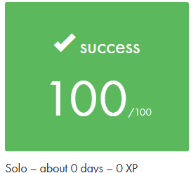

# 42 Exam Rank 05


My personal preparation code for **42 Exam Rank 05**.

## 🏆 My exam result — 100%



I passed **parts 1 and 2** and scored **100%**. The exercises I received were:

| Part | Exercise | Language | Result |
| --- | --- | --- | --- |
| 1 | **vect2** | C++ | ✅ Passed |
| 2 | **Life** | C | ✅ Passed |

These are the solutions I used to prepare for the exam, and they worked for me: I successfully completed both exercises during my exam.

## 📂 Repository contents

| Folder | Contents | Status |
| --- | --- | --- |
| [`vect2/`](./vect2/) | A two-dimensional integer vector class with operator overloading. | My part 1 exam exercise — passed |
| [`life/`](./life/) | Conway's Game of Life, with an initial board drawn through standard input. | My part 2 exam exercise — passed |
| [`bigint/`](./bigint/) | C++ practice with large integers. | Additional preparation |
| [`bsq/`](./bsq/) | Biggest Square practice in C. | Additional preparation |
| [`polyset/`](./polyset/) | C++ practice with bags, searchable containers and sets. | Work in progress — some files are empty |

The **100% result refers to my exam with vect2 and Life**, not to validation of every exercise in this repository.

## ⚙️ Compile and run

Run these commands from the repository root.

### vect2

Compile the implementation into an object file:

```bash
c++ -Wall -Wextra -Werror -std=c++98 -c vect2/vect2.cpp -o vect2.o
```

To try the class, write your own `main.cpp` including `vect2.hpp`, then compile and run:

```bash
c++ -Wall -Wextra -Werror -std=c++98 -I vect2 main.cpp vect2/vect2.cpp -o vect2_test
./vect2_test
```

### Life

```bash
cc -Wall -Wextra -Werror -std=c99 life/life.c -o life_test
printf 'dsxdd' | ./life_test 5 5 1
```

Arguments: `width height iterations`.

| Key | Action |
| --- | --- |
| `w` | Move up |
| `a` | Move left |
| `s` | Move down |
| `d` | Move right |
| `x` | Toggle the pen to draw living cells |

The program reads the drawing commands, simulates the requested number of generations, and prints the final board using `O` for living cells and spaces for dead cells.

## 👤 Author

**Resul Tektas** · 42 Brussels · [@rtektas](https://github.com/rtektas)
